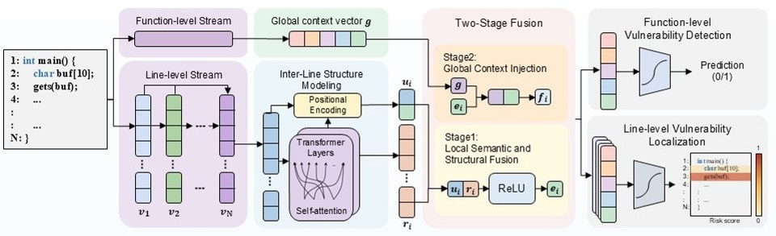

# REVEAL: Multi-granularity Code Representation Fusion for Joint Vulnerability Detection and Localization
Software vulnerabilities pose a critical threat to modern software systems as codebases continue to grow in scale and complexity. Although deep learning has significantly advanced automated vulnerability detection, existing approaches primarily focus on function-level prediction, while accurate vulnerability localization at the statement level remains challenging. To address this issue, we propose REVEAL, a multi-granularity code REpresentation fusion method for joint Vulnerability dEtection And Localization. REVEAL employs CodeT5 to learn semantic code representations and incorporates Transformer-based modeling to capture sequential and dependency relationships among code lines. It further integrates function-level global context with line-level local features through a multi-granularity fusion strategy, enabling more precise modeling of complex vulnerability patterns. Dual-task learning is then enforced to jointly optimize function-level vulnerability detection and line-level vulnerability localization. Experiments on the BigVul dataset demonstrate that REVEAL consistently outperforms the baseline methods in fine-grained vulnerability localization, improving the F1-score by 11.35 percentage points and the Top-10% Accuracy by 30.84 points over the widely used LineVD baseline, while also achieving the best function-level F1-score and Recall. Under a cross-project setting in which five projects are entirely unseen during training, REVEAL still obtains the best function-level and line-level F1 and degrades less than all baselines. Ablation studies further confirm the effectiveness of the proposed fusion and structural modeling strategies.

# Design of REVEAL

## Requirements
Make sure to install the following major libraries to setup the environment of REVEAL framework:
* numpy==2.5.0
* pandas==3.0.3
* scikit_learn==1.9.0
* torch==2.5.1+cu121
* tqdm==4.67.1
* transformers==4.47.1

# Datasets
If you want to retrain the model, you need to download training, evaluation, and testing dataset.  
The original train dataset can be downloaded at: <https://drive.google.com/uc?id=1ldXyFvHG41VMrm260cK_JEPYqeb6e6Yw>.  
The original val dataset can be downloaded at: <https://drive.google.com/uc?id=1yggncqivMcP0tzbh8-8Eu02Edwcs44WZ>.  
The original test dataset can be downloaded at: <https://drive.google.com/uc?id=1h0iFJbc5DGXCXXvvR6dru_Dms_b2zW4V>.  
Then store the above dataset in the "Bigvul_dataset" folder.

# Source
## Step1: Data preprocessing
First, download the original dataset to the "bigvul_dataset" directory.Then execute the following command (note: this Python file contains multiple steps, including the initial extraction of vulnerability information and downsampling, and can be run step by step according to your needs).  
```Python
cd .\src\data_process\
python useful_column_toCSV.py
```
If you want to attempt to reproduce the Cross-project experiment, please continue to use the aforementioned original dataset and run the following command to re-construct the cross-project dataset.
```
python build_cross_project_balanced_dataset.py
```

## Step2: Train&Evaluatemodels
```Python
cd ..
python Fun_Line_VD_Trans+PosEncoding.py
```


## Step3: Ablation experiment
The ablation experiments mainly include the following several variants: eliminating the "Position Encoding"、"Transformer Layers"、"Pre-trained Language Model"、"Inter-line structure modeling module" and the "Function-level global semantic module"and so on. Please execute the following programs separately.
```Python
cd .\src\ablation\
python FLVD_Multi-Task_To_Single-Task.py
python FLVD_Structural+Global.py
python Fun_Line_VD_TransformerLayer.py
......
```

## Step4: Feature Fusion Experiment
The feature fusion experiment mainly consist of three variants: 1)the sum of line semantic  and structural features serves as query Q and the global function feature FeatGlobal serves as both key K and value V in a cross-attention layer; 2)all three feature sources are  concatenated directly into a single vector; 3)The line-level final features do not undergo a second-stage fusion with the global features; instead, they are directly used as the input for the classifier.
```Python
cd .\src\feature_fusion\
python Fun_Line_VD_TransformerLayer_AllCat.py
python FLVD_A+B_Then_C_CrossAttention.py.py
python FLVD_Trans+PosEncoding_NoTwoStageFusion.py
```
## Step5: Cross-project Experiment
If you wish to replicate this part of the experiment, please prepare the Cross-project dataset from the Data preprocessing stage in advance,and carry out the following instructions.
```
cd .\src\
python FLVD_Trans+Pos_Cross-project.py
```

